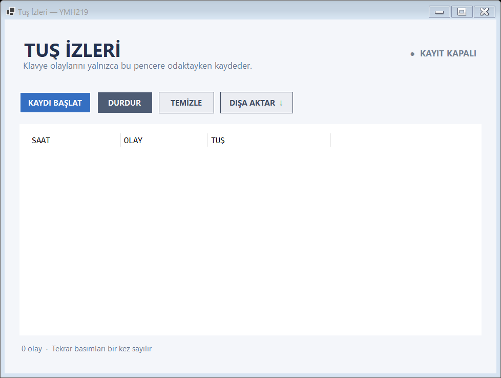
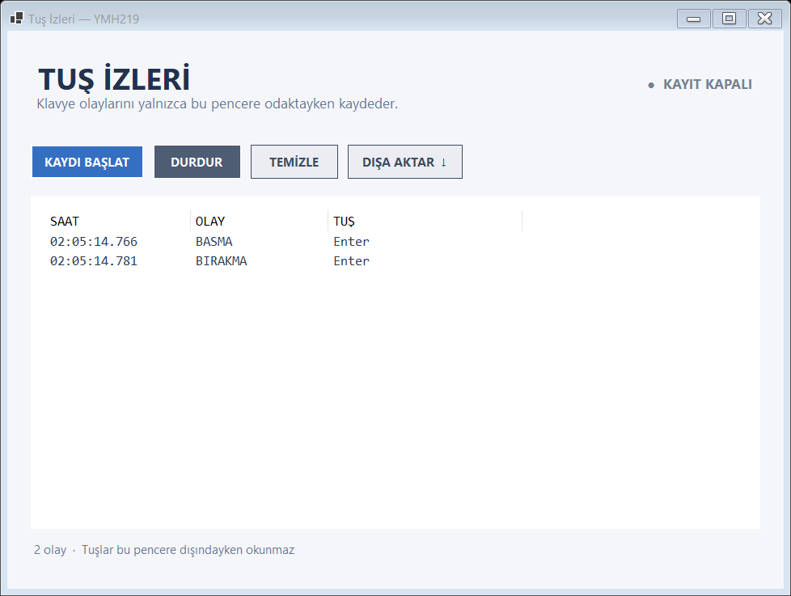

# YMH219 — Tuş İzleri

Klavye olaylarını yalnızca kendi penceresi odaktayken gösteren eğitsel bir Windows Forms uygulamasıdır. Sistem genelinde tuş izlemez.

## Teknoloji

- C# / .NET 10, Windows Forms
- `KeyboardRecorder` olay işleme sınıfı ve `KeyboardEventRecord` kayıt modeli
- `KeyDown`, `KeyUp`, `StreamWriter`/dosya API'leri

## Özellikler

- Başlat, durdur, temizle ve `.txt` dışa aktar
- Tuş adı ve milisaniyeli zaman damgası
- Basma ve bırakma olayları ayrı gösterilir
- Basılı tutma sırasında tekrarlanan `KeyDown` mesajları tek olaya indirgenir
- Global hook, gizli çalışma veya başka uygulamalardan veri toplama yoktur

## Kurulum ve çalıştırma

```powershell
git clone https://github.com/Halit1elnehsen/YMH219-KeyEventLogger.git
cd YMH219-KeyEventLogger
dotnet restore
dotnet run
```

Windows 10/11 ve .NET 10 SDK gerekir. Kayıt dosyası yalnızca kullanıcı dışa aktarmayı seçerse belirtilen yere yazılır.

## Ekran görüntüleri





## Test ve sınırlamalar

Yerel işlev kontrolünde aynı tuş için tekrarlanan basışın tek basış olarak tutulduğu, bırakma olayının ayrı yazıldığı ve durdurma sonrasında kayıt alınmadığı doğrulandı. Dışa aktarma penceresi masaüstü UI otomasyonu engeli nedeniyle etkileşimli olarak denenemedi. Uygulama kapatıldığında ekrandaki kayıt listesi kalıcı tutulmaz.

## Öğrenci

**Halid Elnehsen — 250541617**
